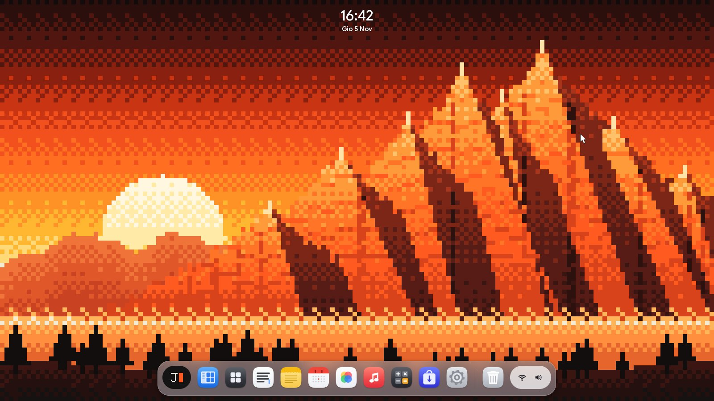
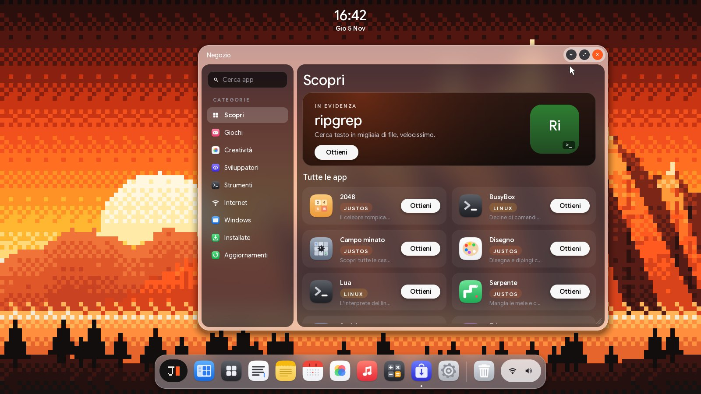

JustOS: un sistema operativo per PC x86-64 scritto da zero in Rust, con il linguaggio ArcScript.

La prima versione con il nome JustOS.

## Novità della 0.7

- **arcOS diventa JustOS**: nuovo nome, nuovo marchio J▮ e licenza GPL-3.0-or-later. ArcScript, ArcStudio e i pacchetti `.arc` restano. JustFS ha un formato nuovo: i dischi creati con arcOS non si leggono più.
- **Il nuovo stile JustOS**: niente barra in alto, l'ora e la data fluttuano sullo sfondo; il dock in vetro chiaro ha il marchio J▮ (menu di sistema) a sinistra e lo stato (rete, suono, anello della batteria) a destra, che apre il centro di controllo con account, riquadri, cursori verticali di volume e luminosità, Spegni, Blocca e Riavvia. Finestre di vetro rosato con tre pulsanti tondi su una pillola chiara; a schermo intero (F11) l'ora passa nella riga del titolo. Nuovo sfondo a pixel e cinque foto delle Dolomiti; il carattere è Google Sans Flex.
- **Aggiornamenti di sistema A/B**: il kernel e i driver stanno in due slot. Un aggiornamento si scrive in quello libero e parte in prova; se non si avvia, JustOS torna da solo alla versione di prima. Info sistema cerca, installa e torna indietro.
- **App nella sandbox**: ogni app ha la sua cartella; Documenti, Immagini, gli altri dischi, la rete, la fotocamera e il microfono si usano solo con un permesso, chiesto la prima volta e gestito in *Impostazioni → Privacy delle app*. Il selettore di file dà accesso solo al file scelto.
- **Aggiornamenti delle app in background**, da un indice firmato (Ed25519), con la sezione Aggiornamenti nel Negozio.
- **Portatili**: batteria, alimentatore, coperchio e temperature, letti dal firmware con un interprete ACPI scritto da zero; sospensione in RAM dal menu, dal tasto e chiudendo il coperchio, con la schermata di blocco al risveglio.
- **Schermi ad alta densità**: l'interfaccia a 2× da 2560×1440 in su, o a scelta nelle Impostazioni.
- **Il desktop**: desktop virtuali e vista d'insieme (F3), finestre agganciate a metà e a quarti, ricerca globale con Ctrl+Spazio, file trascinati tra le finestre, schede in File (Ctrl+T), schermata di blocco con password.
- **JavaScript nel Browser**: `justjs`, un interprete scritto da zero, con il DOM, gli eventi, i timer e `fetch`; basta per i siti semplici.
- **ArcStudio**, l'ambiente di sviluppo per ArcScript.
- **Più programmi**: i programmi Windows aprono finestre semplici, l'app dalvik esegue programmi Android e Java semplici; un doppio clic installa pacchetti `.deb`, `.tar.gz`, `.tgz`, `.tar`, `.zip` e `.gz` con un programma Linux statico o Windows x64.
- **Tutti i processori**: il kernel usa fino a 16 core.
- **Schermi**: driver per Cirrus e per il framebuffer di qualsiasi firmware.

Mancano ancora Wi-Fi, Bluetooth e l'accelerazione grafica: sulle schede video vere (Intel, AMD, nVidia) si usa il framebuffer del firmware. Lo stato di ogni driver è in [docs/driver.md](https://github.com/matthias-peterlini/justOS/blob/main/docs/driver.md#hardware-supportato), cosa manca e in che ordine nella [roadmap](https://github.com/matthias-peterlini/justOS/blob/main/docs/roadmap.md).

## File

| File | Cosa farne |
|---|---|
| `justos.iso` | **CD live**: si avvia in una macchina virtuale (VirtualBox, VMware, QEMU, Hyper-V di prima generazione) o da un CD, con BIOS o UEFI, senza disco rigido. Il sistema gira in memoria: le modifiche si perdono allo spegnimento. |
| `justos-img.zip` | **Immagine di disco** (256 MiB, BIOS e UEFI): scompattata, si scrive su una chiavetta USB (balenaEtcher, Rufus in modalità DD, `dd`) per avviare un PC vero, con le modifiche che restano. Secure Boot va disattivato. |
| `SHA256SUMS` | le impronte dei due file |

## Provarlo

- **QEMU**: `qemu-system-x86_64 -m 512M -cdrom justos.iso -device ich9-intel-hda -device hda-output`
- **VirtualBox**: nuova macchina "Other/Unknown (64-bit)", 512 MiB di memoria, nessun disco, `justos.iso` nel lettore CD.

Al primo avvio JustOS chiede nome, tastiera e sfondo, poi apre la scrivania. Il Terminale (nel dock) ha la shell: `help` elenca i comandi. Documentazione nel [README](https://github.com/matthias-peterlini/justOS#readme).
