<div align="center">


### Un sistema operativo per PC x86-64, scritto da zero in Rust.

Boot loader, kernel, file system, driver, interfaccia grafica e linguaggio di
programmazione: tutto progettato apposta. E sopra ci girano anche Firefox,
i programmi Linux, quelli Windows e le app Android.

[](https://github.com/matthias-peterlini/justOS/releases/latest)
[](https://github.com/matthias-peterlini/justOS/actions/workflows/build.yml)
[](LICENSE)
[](https://www.rust-lang.org)

**[Scarica il CD live](https://github.com/matthias-peterlini/justOS/releases/latest/download/justos.iso)** ·
**[Immagine per chiavetta USB](https://github.com/matthias-peterlini/justOS/releases/latest/download/justos-img.zip)** ·
[Novità](https://github.com/matthias-peterlini/justOS/releases/latest) ·
[Documentazione](docs/) ·
[Roadmap](docs/roadmap.md) ·
[justos.dev](https://justos.dev)

<br>

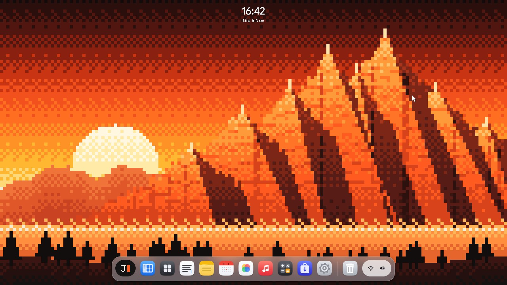

<sub>La scrivania: l'ora che fluttua sullo sfondo, il dock con il menu J▮ a sinistra e lo stato a destra.</sub>

<br><br>

[Perché](#perché-justos) ·
[Com'è](#comè) ·
[Le app degli altri sistemi](#le-app-degli-altri-sistemi) ·
[Provarlo](#provarlo-in-un-minuto) ·
[Cosa c'è](#cosa-cè) ·
[Compilare](#compilare)

</div>

<br>

## Perché justOS

<table>
<tr>
<td width="33%" valign="top">

**Scritto da zero**

Nel sistema non c'è codice di Linux, Unix, DOS o Windows e nessuna crate di
terze parti: solo il compilatore Rust, `core` e `alloc`.

</td>
<td width="33%" valign="top">

**Si avvia ovunque**

La stessa immagine parte da BIOS e da UEFI, da una chiavetta USB, da un
disco o come CD live.

</td>
<td width="33%" valign="top">

**Pulito e veloce**

Niente barra in alto: un dock e finestre a pixel morbidi, tema scuro o chiaro, animazioni
morbide e l'interfaccia a 2× sugli schermi ad alta densità.

</td>
</tr>
<tr>
<td valign="top">

**Si aggiorna da solo**

Come un telefono: la versione nuova va nell'altro slot di sistema e parte in
prova. Se qualcosa va storto, si torna da soli a quella di prima.

</td>
<td valign="top">

**App al sicuro**

Ogni app vive nella sua sandbox e chiede il permesso per cartelle, rete,
fotocamera e microfono, come su un telefono.

</td>
<td valign="top">

**Esegue anche gli altri**

Firefox è già installato. Programmi Linux, Windows a 64 e a 32 bit, Java
e app Android girano accanto alle app di justOS, senza modifiche.

</td>
</tr>
<tr>
<td valign="top">

**Ha il suo linguaggio**

JustScript, con compilatore e macchina virtuale, e l'IDE **JustStudio** con
gli errori sottolineati mentre scrivi e l'anteprima dal vivo.

</td>
<td valign="top">

**Pronto per i portatili**

Batteria, coperchio, temperature e sospensione in RAM, letti dal firmware
con un interprete ACPI scritto da zero.

</td>
<td valign="top">

**Il web, a modo suo**

Il Browser ha un motore HTML e CSS e un interprete JavaScript, anche
questi scritti da zero.

</td>
</tr>
</table>

## Com'è

<table>
<tr>
<td width="50%">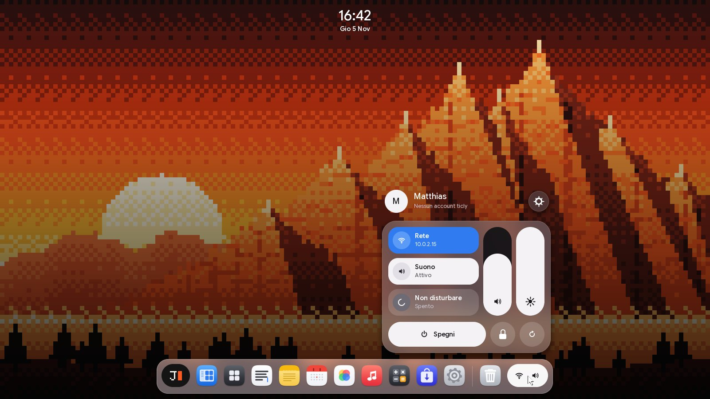<br><b>Centro di controllo</b>: account, rete, suono, volume e luminosità, spegni.</td>
<td width="50%">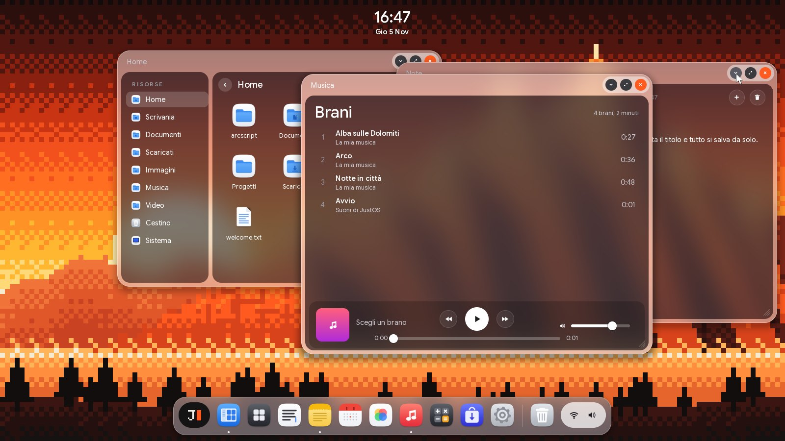<br><b>Finestre</b>: Musica, Note e File insieme.</td>
</tr>
<tr>
<td>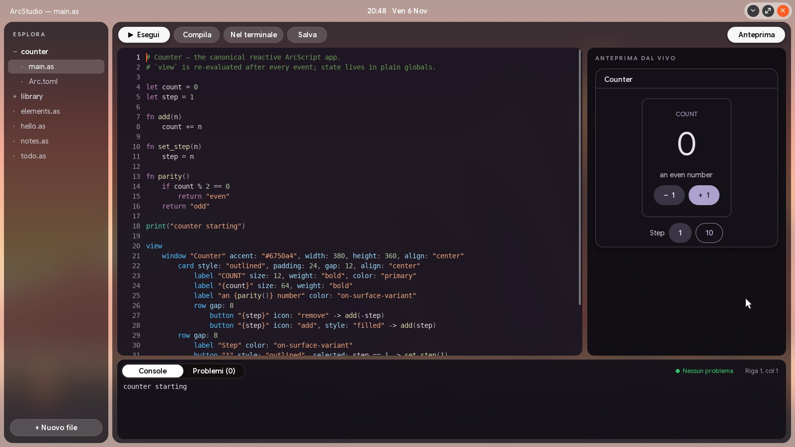<br><b>Schermo intero</b>: JustStudio prende tutto lo schermo, con l'ora nel titolo.</td>
<td>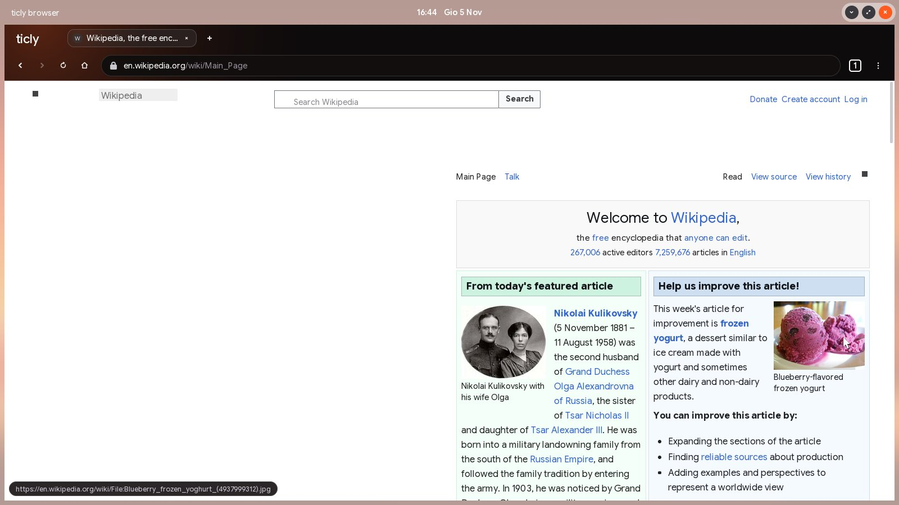<br><b>Browser</b>: Wikipedia con il motore web di justOS.</td>
</tr>
<tr>
<td>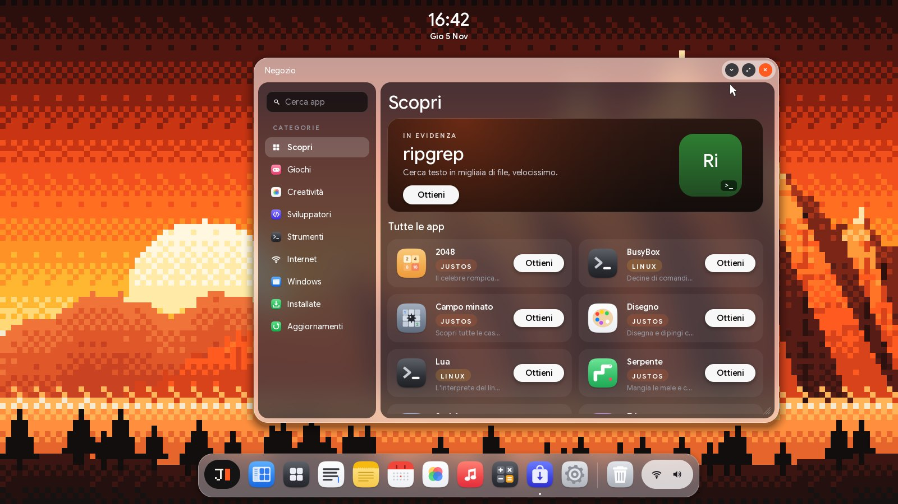<br><b>Negozio</b>: giochi e app, installati con un clic.</td>
<td>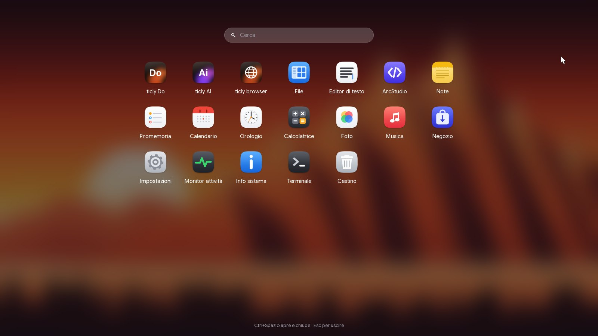<br><b>Applicazioni</b>: tutte le app, con ricerca (Ctrl+Spazio).</td>
</tr>
</table>

<details>
<summary><b>Altre schermate</b></summary>
<br>
<table>
<tr>
<td width="50%"><br><b>Avvio</b>: solo il logo e una barra di caricamento.</td>
<td width="50%"><br><b>Primo avvio</b>: la configurazione guidata parte con INIZIA.</td>
</tr>
<tr>
<td>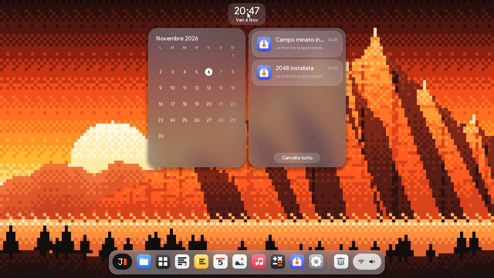<br><b>Centro notifiche</b>: il calendario e le notifiche ricevute.</td>
<td>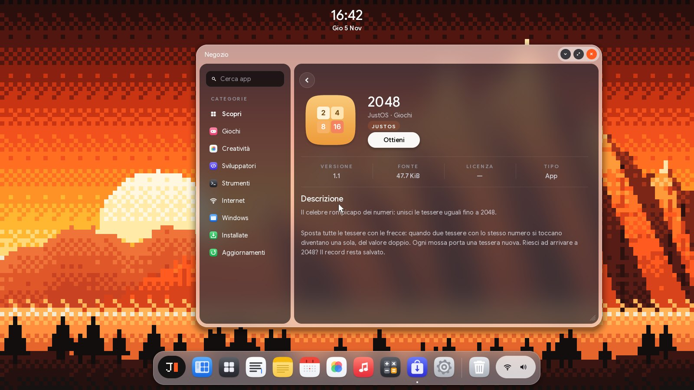<br><b>La pagina di un'app</b>: descrizione, versione, dimensioni.</td>
</tr>
<tr>
<td>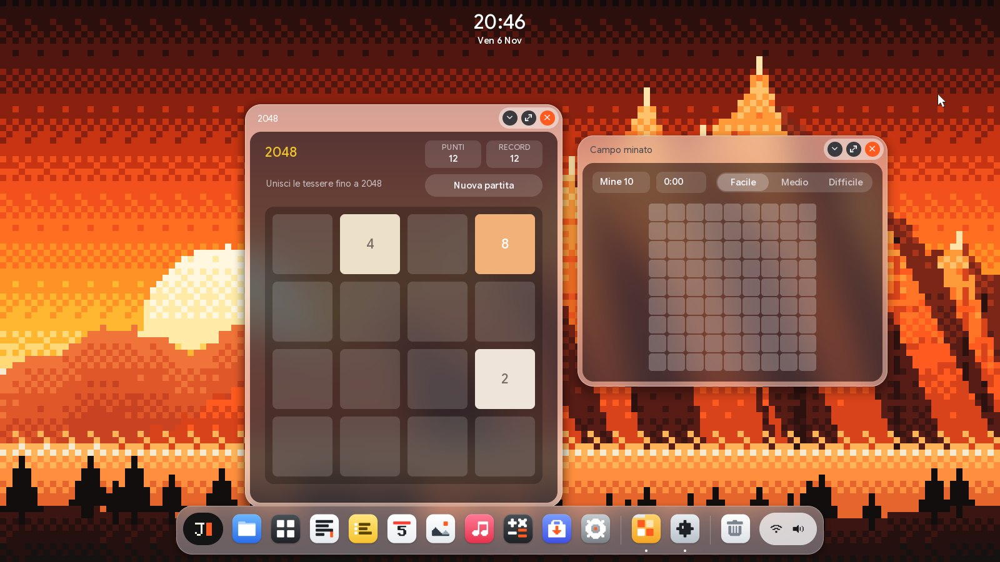<br><b>Giochi</b>: 2048 e Campo minato, programmi del Negozio.</td>
<td>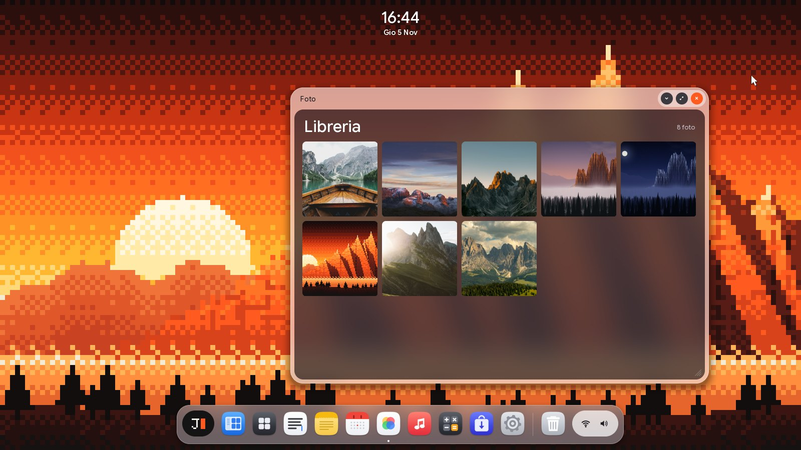<br><b>Foto</b>: la libreria delle immagini.</td>
</tr>
<tr>
<td>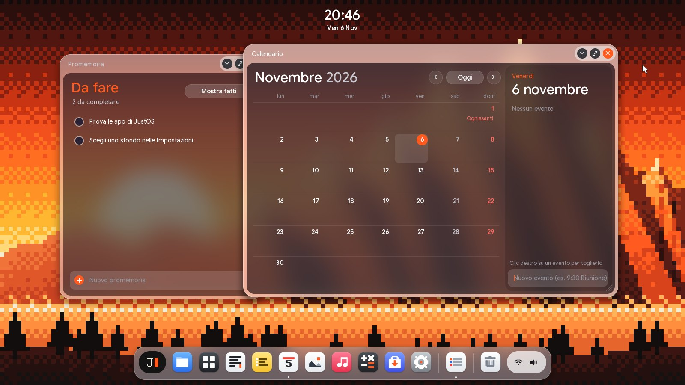<br><b>Calendario e Promemoria</b>: eventi, feste, cose da fare.</td>
<td>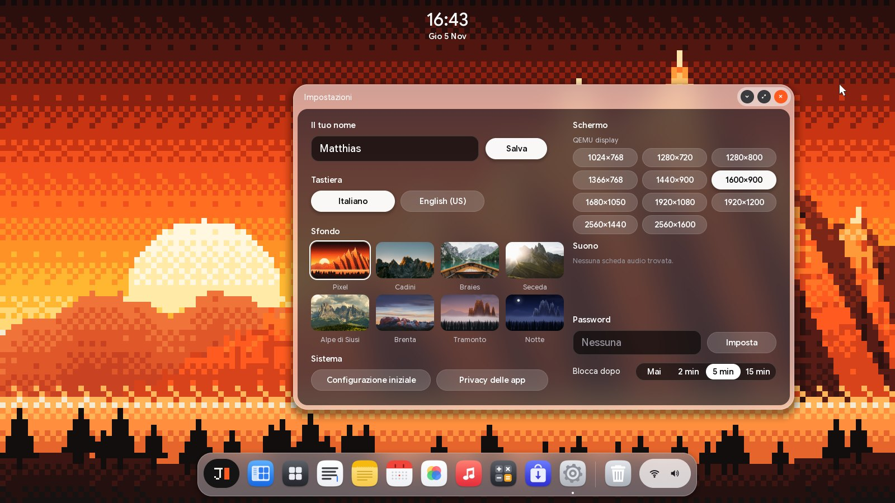<br><b>Impostazioni</b>: nome, tastiera, sfondo, schermo, password.</td>
</tr>
</table>
</details>

## Le app degli altri sistemi

justOS ha le sue app, ma non chiede di rinunciare a quelle che usi già. Ecco
a che punto è ogni famiglia, senza giri di parole:

| Da dove | Stato | Cosa gira |
|---|---|---|
| **Linux** | 🟢 funziona | programmi statici e dinamici con la glibc di Debian, GTK 3, Wayland (il compositor è nel kernel). **Firefox ESR è di serie** e le app Linux con un file `.desktop` compaiono in Applicazioni. Non c'è un server X11 né l'accelerazione 3D |
| **Windows** | 🟡 in parte | `.exe` a 64 bit piccoli con `winrun`, scritto da zero. I programmi veri con **Wine 10** (`make wine-image`), a 64 e a 32 bit, con finestre di justOS. Mancano DirectX accelerato e l'audio; i programmi grandi e recenti spesso non partono ancora |
| **Android** | 🟡 agli inizi | bytecode Dalvik (`.dex`, `.apk`, `.jar`) con un interprete scritto da zero e una piccola parte del framework. Il driver binder c'è; le app vere del Play Store non girano ancora |
| **macOS** | 🔴 no | i pacchetti `.pkg` si aprono e si estraggono, ma i programmi Mach-O non si eseguono: servirebbero le librerie di Apple |

Nell'app File un doppio clic avvia i programmi Linux con finestra e, nell'immagine
con Wine, i `.exe` (senza Terminale); le pagine web si aprono in Firefox. I
`.deb` di Debian e Ubuntu (xz, zstd) non si installano ancora e le app per macOS
dicono che non funzionano. La tabella dei casi, con cosa è verificato, è in
[docs/compat.md](docs/compat.md#aprire-con-un-doppio-clic).

I programmi con licenza chiedono l'accesso con il tuo account, come sul loro
sistema: justOS non aggira nessun controllo. I dettagli sono in
[docs/compat.md](docs/compat.md).

## Provarlo in un minuto

1. **Scarica** [`justos.iso`](https://github.com/matthias-peterlini/justOS/releases/latest/download/justos.iso), il CD live (circa 70 MiB).
2. **Avvialo** in una macchina virtuale:
   - **QEMU**:
     ```sh
     qemu-system-x86_64 -m 1G -cdrom justos.iso -device ich9-intel-hda -device hda-output
     ```
   - **VirtualBox**: una macchina "Other/Unknown (64-bit)" con 1 GiB di memoria, senza disco, con `justos.iso` nel lettore CD.
   - **VMware** e **Hyper-V** (prima generazione) vanno bene allo stesso modo.
3. **Scegli** nome, tastiera e sfondo: dopo c'è la scrivania.

Il CD live gira in memoria, quindi le modifiche si perdono allo spegnimento.
Per tenerle, o per avviare un PC vero, c'è
[`justos-img.zip`](https://github.com/matthias-peterlini/justOS/releases/latest/download/justos-img.zip):
è un'immagine di disco da 256 MiB, che si scrive su una chiavetta USB con
balenaEtcher, Rufus in modalità DD o `dd`. Parte con BIOS e con UEFI;
Secure Boot va disattivato.

### Scorciatoie da sapere

| Tasti | Cosa fanno |
|---|---|
| **Ctrl+Spazio** | cerca app, file e impostazioni, e fa i conti |
| **F3** | vista d'insieme e desktop virtuali |
| **F11** | schermo intero |
| **Alt+Tab** · **Ctrl+Q** | passa alla finestra successiva · chiude quella in primo piano |
| **Ctrl+Alt+frecce** | aggancia la finestra a metà schermo, la ingrandisce, la ripristina |
| **logo+L** · **Stamp** | blocca lo schermo · salva una schermata in Immagini |

## Cosa c'è

| | |
|---|---|
| **Di serie** | Firefox, Browser (il motore web di justOS), File, Editor di testo, Note, Promemoria, Calendario, Orologio, Calcolatrice, Foto, Musica, Anteprima, Terminale, Monitor attività, Impostazioni, Info sistema, JustStudio |
| **Nel Negozio** | 2048, Campo minato, Serpente, Sudoku, Tris e Disegno; BusyBox e Lua per il Terminale; programmi Linux e Windows da GitHub. Le app si aggiornano da sole, da un indice firmato |
| **Doppio clic** | un programma parte; un pacchetto `.deb`, `.tar.gz`, `.zip` o `.pkg` si installa da solo |

<details>
<summary><b>Com'è fatto dentro</b></summary>
<br>

| Parte | Cosa fa | Dettagli |
|---|---|---|
| **JustBoot** | loader per BIOS (MBR + secondo stadio in assembly) e per UEFI (un'applicazione EFI in Rust); entrambi scelgono uno dei due slot di sistema (aggiornamenti A/B con ritorno indietro) e passano al kernel la stessa `BootInfo` | [architettura](docs/architettura.md#aggiornamenti-del-sistema-ab) |
| **Kernel** | 64 bit, memoria virtuale a 4 livelli, scheduler preemptivo su tutti i processori, thread, code di attesa, MSI/MSI-X, porte di messaggi tra programmi, ACPI con un interprete AML scritto da zero (spegnimento, sospensione in RAM, batteria, temperature) | [architettura](docs/architettura.md#kernel) |
| **Driver** | pacchetti `.jdp` indipendenti dal kernel: il kernel confronta i manifesti con l'hardware e carica il driver giusto da solo, all'avvio e a sistema avviato | [driver](docs/driver.md) |
| **JustFS** | il file system nativo: blocchi da 4 KiB, extent, controllo di coerenza; volumi con nome (`sys:`, `ram:`, `chiavetta:`) | [architettura](docs/architettura.md#file-system-justfs) |
| **Interfaccia** | splash, configurazione guidata, scrivania con dock, Applicazioni, centro di controllo, notifiche, ricerca globale, desktop virtuali, snap delle finestre, trascinamento dei file, HiDPI, animazioni | [gui](docs/gui.md) |
| **Sicurezza** | identità delle app, sandbox, permessi, password con sale e blocco automatico | [roadmap](docs/roadmap.md#le-basi-comuni) |
| **Programmi** | in modalità utente, ognuno nel suo spazio di indirizzi, a riga di comando o con finestre proprie (`justui`) | [programmi](docs/programmi.md) |
| **Compatibilità** | eseguibili ELF Linux (statici o dinamici con la glibc; GTK 3 e Firefox su Wayland), `.exe` Windows (console e finestre; con Wine 10 anche a 32 bit), programmi Java e app Android (`.dex`, `.apk`) | [compatibilità](docs/compat.md) |
| **JustScript** | il linguaggio di justOS: sorgenti `.jt`, che `justc` compila in pacchetti `.jpk` (o in `.exe` autonomi per Windows, `-t windows`) e `just` esegue (`just main.jt`); JustStudio è l'IDE con anteprima dal vivo | [JustScript](docs/justscript.md#juststudio) |
| **Rete** | ARP, IPv4, ICMP, UDP, TCP, DHCP, DNS; TLS 1.3 con certificati verificati e HTTP(S) | |
| **Web** | `justweb` (HTML, CSS con flexbox, grid, tabelle e media query; PNG, JPEG e GIF) e `justjs` (JavaScript con il DOM, gli eventi, i timer e `fetch`) | [gui](docs/gui.md#il-motore-web) |
| **Shell** | una quarantina di comandi, cronologia, completamento con Tab | qui sotto, nei primi passi |

</details>

<details>
<summary><b>Hardware supportato</b></summary>
<br>

| Tipo | Supportato |
|---|---|
| Dischi | IDE, SATA (AHCI), NVMe, virtio |
| USB | controller USB 3, 2 e 1.1, hub, tastiere, mouse, tavolette, chiavette e dischi (anche come disco di sistema), collegamento a caldo |
| Schede SD | lettori standard (SD Host Controller): schede SD, SDHC, SDXC, MMC |
| Rete | Intel PRO/1000 (e1000, 82574, I217–I219), Intel 82576, I210/I211, I350 e I225/I226 (2,5 Gbit), Realtek RTL8139, RTL8169/8111/8168 e RTL8125 (2,5 Gbit), AMD PCnet, virtio |
| Audio | Intel HD Audio (quasi ogni PC dal 2005), AC'97 |
| Video | qualunque scheda (Intel, AMD, NVIDIA, Hyper-V) con il framebuffer del firmware; cambio di risoluzione con le schede di QEMU (VGA, Cirrus, QXL), VirtualBox (VBoxVGA, VMSVGA), VMware e virtio-gpu |
| Input | tastiera e mouse PS/2 e USB, pulsante di accensione (ACPI) |
| Portatili | batteria, alimentatore, coperchio, temperature ed embedded controller, dall'AML del firmware; sospensione in RAM (S3) dal menu, dal tasto o chiudendo il coperchio |

Mancano ancora il Wi-Fi, il Bluetooth, la sospensione s2idle dei portatili
più recenti, l'accelerazione e il cambio di risoluzione sulle schede video
vere. Lo stato di ogni driver, provato o no, è in
[docs/driver.md](docs/driver.md#hardware-supportato); cosa manca e in che
ordine arriverà è nella [roadmap](docs/roadmap.md).

Prima di provarlo su un PC vero:

- il kernel e i programmi usano tutti i processori (fino a 16);
- sulle schede video vere lo schermo resta nella risoluzione scelta dal
  firmware (il loader UEFI ne sceglie una grande);
- molti driver sono scritti dalla documentazione dei chip e provati in
  QEMU, non ancora su hardware vero.

</details>

<details>
<summary><b>Primi passi nel Terminale</b></summary>
<br>

```
help                   tutti i comandi
dev / drv              dispositivi trovati e driver installati
vol / disks            volumi montati, dischi e partizioni
ls sys:/home           i tuoi file
display 1920x1080      cambia risoluzione (con un driver video)
display scale 2        interfaccia al 200% (auto: secondo lo schermo)
play sys:/system/sounds/avvio.wav
volume 60
net / ping 10.0.2.2    rete
suspend 10             sospende il computer per 10 secondi
install sudoku         un programma dal Negozio
updates check          aggiornamenti delle app
sysupdate              i due slot di sistema (check, install, rollback)
cd sys:/home/justscript
hello.jt               un programma JustScript (o: just hello.jt)
justc build library    lo compila in un pacchetto .jpk
justc build library -t windows    in un .exe che gira da solo su Windows
shutdown / restart
```

</details>

## Compilare

Servono Rust stable (`rustup` installa da solo la versione e i target
giusti, grazie a `rust-toolchain.toml`), `nasm`, `qemu-system-x86_64`, il gcc
di MinGW-w64 (`gcc-mingw-w64-x86-64`, collega il runtime degli `.exe` di
`justc`) e, per provare l'avvio UEFI, OVMF.

```sh
make            # l'immagine di disco build/justos.img (BIOS e UEFI)
make iso        # il CD live build/justos.iso
make run        # avvia justOS in QEMU (anche run-uefi, run-q35, run-nvme, run-iso)
```

L'immagine è da 1 GiB perché porta Firefox; `make SIZE=2G` ne cambia la
dimensione, `make run MEMORY=2G` dà più memoria alla macchina virtuale
(di norma 1 GiB, quanto serve a Firefox). `make wine-image` costruisce
`build/justos-wine.img`, con Wine per i programmi Windows.

<details>
<summary><b>I test</b>: girano tutti in QEMU, senza schermo</summary>
<br>

```sh
make test           # una sessione di comandi scritta (anche test-uefi, test-iso)
make test-drivers   # un avvio per ogni disco, scheda di rete, controller USB e lettore SD
make test-audio     # suoni su ogni scheda audio emulata, registrati e controllati
make test-display   # cambio di risoluzione e risveglio su ogni scheda video emulata
make test-acpi      # pulsante di accensione, batteria, sospensione e risveglio
make test-update    # aggiornamento nell'altro slot, prova, conferma, ritorno indietro
SLEEP=1 make test-drivers  # gli stessi, dopo una sospensione (anche test-audio)
make test-compat    # programmi Linux, Windows (anche con finestre), Java e Android
make test-linux     # lo strato Linux: processi, segnali, socket, binder
make test-wayland   # il compositor Wayland
make test-gtk       # un programma GTK 3 con il tema di justOS
make test-justscript # programmi JustScript
make shots          # usa l'interfaccia (ogni app, il Negozio) e salva le schermate
make check          # test delle librerie e dello strumento host
```

</details>

<details>
<summary><b>Struttura del repository</b></summary>
<br>

| Percorso | Contenuto |
|---|---|
| `boot/bios/`, `boot/uefi/` | JustBoot per BIOS e per UEFI |
| `system/kernel/` | il kernel, con l'interfaccia grafica (`src/gui`) |
| `system/drivers/` | i driver, uno per cartella, ognuno con il suo `driver.manifest` |
| `system/apps/` | i programmi, tra cui `winrun` (programmi Windows), `dalvik` (Java e Android), `justc` e `just` (JustScript) |
| `system/store/` | le app del Negozio (giochi e Disegno), con icona e scheda |
| `system/libs/` | le librerie: ABI dei driver (`justdk`, `justdrv`), programmi (`justrt`), finestre (`justui`), disegno (`justgfx`), JustFS, USB, virtio, JustScript, TLS (`justtls`), web (`justweb`), JavaScript (`justjs`), Dalvik (`justdex`) |
| `tools/justtool/` | strumento host: crea pacchetti, immagini e CD, legge e scrive volumi JustFS |
| `tools/assets/` | i generatori di caratteri, icone, sfondi, suoni, musica e del banner di questa pagina |
| `tools/qemu/` | modelli per QEMU di dispositivi che QEMU non ha (Realtek RTL8169, RTL8168, RTL8125) |
| `rootfs/` | i file del volume di sistema |
| `scripts/` | i test automatici in QEMU |
| `docs/` | la documentazione |

</details>

## Licenza

Copyright (C) 2026 Matthias Peterlini <https://matthiaspeterlini.tech>

justOS è software libero: puoi ridistribuirlo e/o modificarlo secondo i
termini della GNU General Public License pubblicata dalla Free Software
Foundation, nella versione 3 o (a tua scelta) in una qualsiasi versione
successiva (GPL-3.0-or-later). È distribuito nella speranza che sia utile,
ma SENZA ALCUNA GARANZIA, nemmeno quella implicita di COMMERCIABILITÀ o di
IDONEITÀ A UN PARTICOLARE SCOPO. Il testo completo è in [LICENSE](LICENSE) e
su <https://licence.justos.dev>.

I caratteri Google Sans Flex e DejaVu Sans Mono hanno le loro licenze
libere (SIL OFL), in `system/kernel/assets/LICENSES.md`; le foto degli
sfondi sono di Unsplash (licenza Unsplash), con gli autori in
`rootfs/system/gui/wallpapers/CREDITS.txt`.

<div align="center">
<br>
<sub>Scritto da zero, in Rust · <a href="https://justos.dev">justos.dev</a></sub>
</div>
